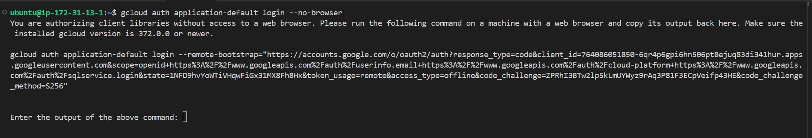

### For new machine please do thi s 4 step to create/destroy machine 

#### 1. Install Tools: Install Terraform and gcloud
#### 2. Create SSH Key
#### 3. Auth & Quota Project: Authenticate with gcloud auth application-default login (or --no-browser + --remote-bootstrap)
#### 4. Init & Apply: In your IaC folder, run terraform init and terraform apply -auto-approve

#### ----------------------------------------------------

### Guide Each Step 

#### 1. Install Tools : Terraform and gcloud
##### + Install gcloud : verify = gcloud --version
```bash
```
```bash
sudo apt-get update && sudo apt-get install -y apt-transport-https ca-certificates gnupg curl lsb-release software-properties-common
curl -fsSL https://packages.cloud.google.com/apt/doc/apt-key.gpg | sudo gpg --dearmor --yes -o /usr/share/keyrings/cloud.google.gpg
sudo chmod 644 /usr/share/keyrings/cloud.google.gpg
echo "deb [signed-by=/usr/share/keyrings/cloud.google.gpg] https://packages.cloud.google.com/apt cloud-sdk main" | sudo tee /etc/apt/sources.list.d/google-cloud-sdk.list
sudo apt-get update && sudo apt-get install -y google-cloud-cli
```

##### +  Install Terraform : verify = terraform version
```bash
curl -fsSL https://apt.releases.hashicorp.com/gpg | sudo gpg --dearmor --yes -o /usr/share/keyrings/hashicorp-archive-keyring.gpg
sudo chmod 644 /usr/share/keyrings/hashicorp-archive-keyring.gpg
echo "deb [arch=$(dpkg --print-architecture) signed-by=/usr/share/keyrings/hashicorp-archive-keyring.gpg] https://apt.releases.hashicorp.com $(lsb_release -cs) main" | sudo tee /etc/apt/sources.list.d/hashicorp.list
sudo apt-get update && sudo apt-get install -y terraform
```

#### 3. Create ssh key pair
```bash
mkdir -p ~/.ssh && chmod 700 ~/.ssh && ssh-keygen -t ed25519 -f ~/.ssh/gcp_key -N "" -C "devops-gcp-control-node"
```

#### 4. ADC login with --no-browser
```bash
gcloud auth application-default login --no-browser
```

###### copy the longest text at the middle and paste to the local window terminal and copy the output paste into the EC2 machine terminal

#### 4.1 Set the quota project
```bash
gcloud auth application-default set-quota-project your-project-id
```

#### 5. Initialize Terraform and validate the configuration
```bash
terraform init && terraform validate
```

##### 5.1 Run terraform apply and check the outputs
```bash
terraform apply -auto-approve
```